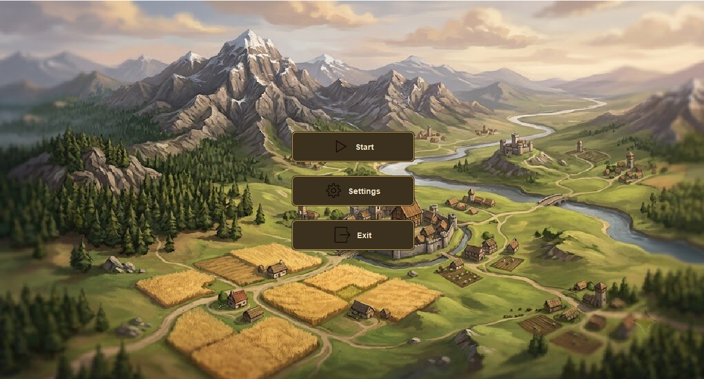
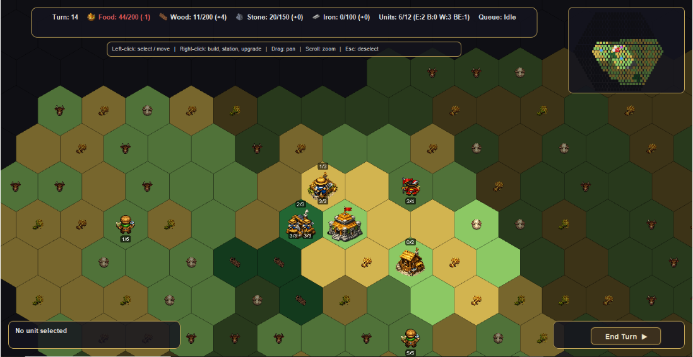
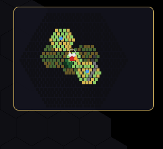

# 🏰 Empire Builder

> **A Turn-Based Strategy Game** — Advanced Programming Course, Sharif University of Technology


---

## 📖 Table of Contents

- [About the Game](#-about-the-game)
- [Features](#-features)
- [Screenshots](#-screenshots)
- [How to Run](#-how-to-run)
- [Gameplay Guide](#-gameplay-guide)
- [Multiplayer Mode](#-multiplayer-mode)
- [Controls](#-controls)
- [Technologies Used](#-technologies-used)
- [Project Structure](#-project-structure)
- [Credits](#-credits)

---

## 🎮 About the Game

**Empire Builder** is a turn-based strategy game where you take control of a fledgling civilization. Your goal is to **explore the unknown**, **gather resources**, **construct buildings**, **expand your territory**, **engage in diplomacy**, **build a military**, and **manage trade** — all while keeping your economy stable and your people fed.

The game features both **Single-Player** and **Multiplayer** modes, allowing you to compete against AI tribes or challenge your friends in real-time network battles.

This project was developed as the Advanced Programming course project at **Sharif University of Technology**, focusing on:
- Object-Oriented Programming (OOP)
- Model-View-Controller (MVC) architecture
- SOLID principles
- Advanced Java (Swing, Streams, Generics)
- **Network Programming (TCP/UDP Sockets)**
- **Client-Server Architecture**
- **Concurrency & Thread-Safety**
- Procedural map generation
- Event-driven architecture
- Serialization for save/load
- Strategy Pattern for trade systems

---

## ✨ Features

| Category | Features |
| :--- | :--- |
| 🗺️ **Map** | Procedurally generated hexagonal grid with forests, mountains, grasslands, and plains. Each tile has unique resources. |
| 🎨 **Map Editor** | Customize and edit the map manually — change terrain types and place resources. |
| 🗺️ **Prebuilt Maps** | 3 balanced prebuilt maps (Balanced Plains, Contested Valleys, Archipelago Wars) ready for multiplayer battles. |
| ⛏️ **Resources** | Manage **Food**, **Wood**, **Stone**, and **Iron**. Each resource has specific production buildings. |
| 🏛️ **Buildings** | Construct Lumber Mills, Stone Mines, Iron Mines, Farms, Stables, and **Bazaars** (trade buildings with 3 tiers). |
| 👷 **Units** | Command **Explorers** (scout), **Builders** (construct with limited charges), **Workers** (gather), **Border Expanders** (claim territory), and **Military Units** (Swordsman, Archer, Cavalry). |
| ⚔️ **Combat** | Military units can attack enemy units and buildings. Buildings have HP and can be destroyed. |
| 🏕️ **Tribes** | Interact with neutral tribes. Each tribe has a **relation state**: Allied, Friendly, Neutral, Displeased, or Enemy. |
| 📜 **Tribe Missions** | Receive and complete missions from tribes to earn rewards and improve relations. |
| 🏪 **Trade System** | Build Bazaars to establish trade routes. Different trade strategies available based on tribe type (Farmer, Mountain, Coastal). |
| 🎪 **Event System** | Real-time game events: building destroyed, unit killed, turn ended, relation changed, and more. |
| 🏴‍☠️ **Pirates** | Encounter pirates that can disrupt your trade routes and attack coastal areas. |
| 🐑 **Animals** | Wildlife system that can be hunted or interacted with for resources. |
| 🔄 **Turn System** | Each unit has **Action Points (AP)**. Plan your moves carefully — every action consumes AP. |
| 🌫️ **Fog of War** | The map starts dark. Only explored tiles become visible. Explorers have the largest vision radius. |
| 🧭 **Auto-Explore** | Explorers can be set to automatically explore unknown territories. |
| 🗺️ **Minimap** | A small overview map shows explored areas, units, and your town hall. Click to teleport the camera. |
| 💾 **Save/Load** | Save your game progress in multiple slots and load anytime. Autosave feature included. |
| 🌊 **Sea Movement** | Units can move on sea tiles with a movement cost of 2 AP. |
| 🔍 **Continuous Zoom** | Smooth, continuous zoom instead of discrete zoom levels. |
| 🎨 **Visual Polish** | Smooth unit animations, custom icons, tooltips on hover, and a sleek dark-themed HUD. |
| 🌐 **Multiplayer** | Real-time client-server gameplay with TCP/UDP networking. |
| 🏠 **Lobby System** | Create/join lobbies, ready up, select maps, and start games with friends. |
| 🤝 **Diplomacy** | Declare war, offer peace, and form alliances with other players. |
| 💼 **Player Trading** | Exchange resources with other players through a trade inbox system. |
| 🎒 **Items** | Produce and use special items like Teleport scrolls and combat boosters. |
| 🎮 **Cheat Codes** | Optional cheat codes for testing (/greedisgood, /marco, /redbull, /gg). |
| 🏆 **Victory Conditions** | Eliminate all opponents by destroying their Town Halls to win the game. |

---

## 📸 Screenshots

| Main Menu | In-Game HUD | Minimap |
| :---: | :---: | :---: |
|  |  |  |

---

## 🚀 How to Run

### Prerequisites
- **Java 17** or higher installed
- **Gradle** (wrapped, no manual installation needed)

### Single-Player Mode

```bash
# Clone the repository
git clone https://github.com/Pouria-8118/CivGame_AP-Project
cd CivGame_AP-Project/app

# Build and run the game in single-player mode
./gradlew run
```

### Multiplayer Mode

Multiplayer requires running both a **Server** and **Client(s)**:

**Step 1: Start the Server**
```bash
cd CivGame_AP-Project/app
./gradlew runServer
```

**Step 2: Start Client(s)** (in separate terminals)
```bash
cd CivGame_AP-Project/app
./gradlew runClient
```

> 💡 **Note:** On Windows, use `gradlew.bat runServer` and `gradlew.bat runClient` instead.

### Alternative: Build JAR and Run

```bash
./gradlew build

# Single-player
java -jar build/libs/empire-builder.jar

# Multiplayer Server
java -jar build/libs/empire-builder.jar --server

# Multiplayer Client
java -jar build/libs/empire-builder.jar --client
```

---

## 🎯 Gameplay Guide

### 🏁 Starting Out
- You begin with a **Town Hall** and **5 units**: 1 Builder, 2 Workers, and 2 Explorers.
- Your starting resources: **50 Food**, **60 Wood**, **20 Stone**, and **0 Iron**.
- Only the tiles immediately around your Town Hall are visible — the rest is hidden by the **Fog of War**.
- Neutral tribes are scattered across the map. Interact with them to gain allies or face enemies.

### 🔄 Turn Structure
Each turn follows this cycle:

1. **Action Points Refreshed** — All units regain their full AP.
2. **Auto-Explore** — Explorers with auto-explore enabled move automatically.
3. **Resource Production** — Buildings with stationed workers produce resources.
4. **Upkeep Deduction** — Each active building consumes 1 Wood per turn. If upkeep is missed for 3 consecutive turns, the building collapses.
5. **Player Actions** — You can move units, build structures, station workers, expand borders, attack enemies, trade, or start production at the Town Hall.
6. **End Turn** — Click the **"End Turn"** button. If any unit still has AP left, you'll receive a warning.

### 🏗️ Buildings & Production

| Building | Terrain Required | Produces | Worker Capacity | Production per Worker |
| :--- | :--- | :--- | :--- | :--- |
| 🪵 **Lumber Mill** | Forest | Wood | 3 | 3 Wood/turn |
| 🪨 **Stone Mine** | Mountain (with Stone) | Stone | 3 | 2 Stone/turn |
| ⛏️ **Iron Mine** | Mountain (with Iron) | Iron | 2 | 1 Iron/turn |
| 🌾 **Farm** | Grassland (Wheat/Rice) | Food | 3 | 3 Food/turn |
| 🐄 **Stable** | Plain (Cattle/Sheep) | Food | 2 | 2 Food/turn |
| 🏪 **Bazaar** (Tier 1-3) | Any (within border) | Trade Income | — | Generates gold/trade resources based on tier |

### 🧑‍🌾 Units Overview

| Unit | Role | AP | Vision | Special |
| :--- | :--- | :--- | :--- | :--- |
| 🧭 **Explorer** | Scouting | 4 | 3 tiles | Can auto-explore; reveals fog of war |
| 🔨 **Builder** | Construction | 4 | 1 tile | Has 3 charges; consumed when charges run out |
| 🪣 **Worker** | Resource gathering | 3 | 1 tile | Must be stationed in a building to produce |
| 🚩 **Border Expander** | Territory expansion | 4 | 1 tile | Expands borders and is consumed after use |
| ⚔️ **Swordsman** | Melee combat | 3 | 1 tile | Can attack adjacent enemies |
| 🏹 **Archer** | Ranged combat | 2 | 2 tiles | Can attack from a distance |
| 🐴 **Cavalry** | Fast assault | 4 | 2 tiles | High mobility, can attack and move |

### 🏕️ Tribes & Relations

| Relation State | Description |
| :--- | :--- |
| 🤝 **Allied** | Strongest bond. Tribes share resources and provide military support. |
| 😊 **Friendly** | Positive relations. Tribes offer better trade deals and missions. |
| 😐 **Neutral** | Default state. No special interactions. |
| 😠 **Displeased** | Negative relations. Tribes may refuse trade and become hostile. |
| ⚔️ **Enemy** | Hostile state. Tribes may attack your units and settlements. |

### 📜 Tribe Missions
- Tribes offer missions (quests) that you can accept.
- Completing missions improves relations and grants rewards (resources, units, etc.).
- Mission status can be tracked in the game UI.

### 🏪 Trade System (Bazaar)
- Build a **Bazaar** in any empty tile within your borders.
- Upgrade the Bazaar to Tier 2 and Tier 3 for increased trade income.
- Trade strategies vary based on tribe types:
  - **Farmer Tribes** — Food-based trade
  - **Mountain Tribes** — Stone/Iron-based trade
  - **Coastal Tribes** — Maritime trade routes

### 🏛️ Town Hall Upgrades

| Upgrade | Cost | Effect |
| :--- | :--- | :--- |
| 📦 **Storage Upgrade** (x2) | Wood: 20, Stone: 30 | +100 capacity for all resources |
| 🪨 **Stone Mining Tech** | Wood: 25, Stone: 15 | Unlocks Stone Mine construction |
| ⛏️ **Iron Mining Tech** | Wood: 30, Stone: 20 | Unlocks Iron Mine construction |
| 🔧 **Professional Tools** | Stone: 40, Iron: 20 | Stone & Iron production ×1.5 |
| 🏘️ **Settlement Tech** | Wood: 40, Stone: 30 | +5 Unit Cap, creates a settlement on an empty tile |

---

## 🌐 Multiplayer Mode

### 🏠 Lobby System
- **Host** creates a lobby and selects the map
- **Players** join the lobby and click "Ready"
- Host clicks "Start Game" when all players are ready
- **Enable Cheats** toggle (host-only) allows cheat codes during the game

### 🤝 Diplomacy System
Players can interact through diplomatic actions:

| Action | Description |
| :--- | :--- |
| ⚔️ **Declare War** | Attack other players' units and buildings |
| 🕊️ **Offer Peace** | Propose peace to end hostilities |
| 🤝 **Propose Alliance** | Form an alliance to share vision and coordinate attacks |

**Alliance Benefits:**
- **Shared Vision** — Allies can see each other's explored tiles in real-time
- **No Friendly Fire** — Cannot attack allied units
- **Coordinated Strategy** — Plan attacks together

### 💼 Player Trading
- Open the **Trade** menu to send resource offers to other players
- Recipients receive offers in their **Trade Inbox**
- Accept or reject offers — resources are exchanged instantly
- Only available during your turn

### 🎒 Item System
- Produce items at the Town Hall (requires Iron)
- Use items on your units for special effects:
  - **Teleport Scroll** — Instantly move a unit to any visible tile
  - **Combat Boosters** — Increase unit combat effectiveness

### 🎮 Cheat Codes (Optional)
If cheats are enabled in the lobby, type these commands in chat:

| Command | Effect |
| :--- | :--- |
| `/greedisgood` | +500 Food, Wood, Stone, Iron |
| `/marco` | Remove Fog of War entirely |
| `/redbull` | Refill all units' Action Points |
| `/gg` | Instantly eliminate all opponents (victory) |
| `/iknowkungfu` | Convert all Workers to Cavalry |
| `/upgradeth` | Max upgrade Town Hall + full heal |

### 🏆 Victory Conditions
- **Eliminate all opponents** by destroying their Town Halls
- When a player's Town Hall is destroyed, they are **eliminated** from the game
- All their units and buildings are removed from the map
- Last player standing wins!

### 🌫️ Vision Sharing
- **Allies share vision** in real-time
- When an ally's unit moves, you see the newly revealed tiles
- When alliance breaks, shared vision is immediately revoked
- Fog of War applies normally to non-allied players

---

## ⌨️ Controls

| Action | Input |
| :--- | :--- |
| **Select Unit** | Left-click on a unit |
| **Cycle Units on Same Tile** | Left-click repeatedly |
| **Move Unit** | Left-click on a reachable tile |
| **Open Context Menu** | Right-click on a unit or tile |
| **Pan Camera** | Click and drag on the map |
| **Zoom In/Out** | Mouse scroll wheel (continuous) |
| **Deselect Unit** | Press `Esc` |
| **Toggle Fullscreen** | Press `F11` |
| **End Turn** | Click the "End Turn" button |
| **Open Map Editor** | From main menu |
| **Open Inventory** | Click "Inventory" button (left panel) |
| **Open Trade** | Click "Trade" button (multiplayer only) |
| **Open Trade Inbox** | Click "Inbox" button (multiplayer only) |

---

## 🛠️ Technologies Used

- **Java 17** — Core language
- **Swing** — GUI framework
- **Gradle** — Build automation
- **Java Sound API** — Background music playback
- **Java Serialization** — Save/Load system
- **Java Networking (Sockets)** — TCP/UDP client-server communication
- **ConcurrentHashMap** — Thread-safe game state management
- **JSON Serialization (Gson)** — Network message protocol
- **Custom Hex Grid** — Procedural map generation with axial coordinates
- **MVC Architecture** — Clean separation of concerns
- **Event-Driven Architecture** — Loose coupling between components
- **Strategy Pattern** — Trade strategies and tribe behaviors
- **Observer Pattern** — Real-time state synchronization

---

## 📁 Project Structure

```
empire-builder/
├── app/
│   ├── src/
│   │   └── main/
│   │       ├── java/civgame/
│   │       │   ├── audio/          # Music and sound
│   │       │   ├── client/         # Client-side networking
│   │       │   ├── controller/     # Game logic & event handling
│   │       │   │   ├── game/       # In-game controllers
│   │       │   │   ├── lobby/      # Lobby controllers
│   │       │   │   └── menu/       # Menu controllers
│   │       │   ├── model/          # Data & business logic
│   │       │   │   ├── animal/     # Animal system
│   │       │   │   ├── building/   # Building definitions
│   │       │   │   ├── combat/     # Combat & military units
│   │       │   │   ├── diplomacy/  # Player relations
│   │       │   │   ├── event/      # Event system
│   │       │   │   ├── game/       # Core game logic
│   │       │   │   ├── item/       # Item system
│   │       │   │   ├── map/        # Map & hex grid
│   │       │   │   ├── pirate/     # Pirate system
│   │       │   │   ├── resource/   # Resource management
│   │       │   │   ├── trade/      # Trade system
│   │       │   │   └── tribe/      # Tribe & relations
│   │       │   ├── network/        # Network protocol & messages
│   │       │   │   └── message/    # Message types (Request/Response/Broadcast)
│   │       │   ├── server/         # Server-side networking
│   │       │   │   ├── combat/     # PvP combat service
│   │       │   │   ├── diplomacy/  # Diplomacy manager
│   │       │   │   ├── game/       # Multiplayer game state
│   │       │   │   ├── handler/    # Message handlers
│   │       │   │   ├── item/       # Item service
│   │       │   │   ├── lobby/      # Lobby manager
│   │       │   │   └── trade/      # Trade service
│   │       │   ├── util/           # Utilities & helpers
│   │       │   └── view/           # UI components (Swing)
│   │       │       ├── editor/     # Map editor
│   │       │       ├── game/       # Game view
│   │       │       ├── hud/        # HUD components
│   │       │       ├── item/       # Item UI
│   │       │       ├── lobby/      # Lobby UI
│   │       │       ├── menu/       # Menu views
│   │       │       └── trade/      # Trade UI
│   │       └── resources/          # Images, audio, assets
│   ├── saves/                      # Save game files
│   └── build.gradle
├── screenshots/                    # Screenshots for README
└── README.md
```

---

## 👨‍💻 Credits

**Developed by** — *Pouria Asnaashari*  
**Course** — Advanced Programming, Sharif University of Technology  
**Semester** — Spring 2026  
---

## 📜 License

This project is for educational purposes only. All rights reserved.

---

## 🙏 Acknowledgments

- Hex grid algorithms adapted from [Red Blob Games](https://www.redblobgames.com/grids/hexagons/)
- Icons designed with ❤️ using open-source assets

---

⭐ **If you enjoyed this project, don't forget to star the repository!** ⭐